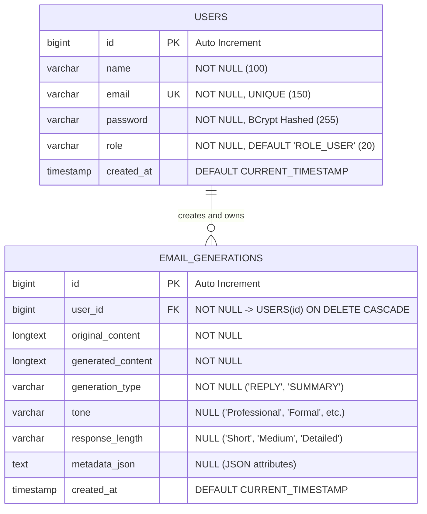

# SmartMail AI – Database Architecture & Design

**Database Name**: `smartmail_db`
**Database Management System (DBMS)**: MySQL 8.x
**Storage Engine**: InnoDB
**Character Encoding**: `utf8mb4`
**Collation**: `utf8mb4_unicode_ci`

---

## 📊 1. Entity-Relationship (ER) Diagram

---

## 🗄️ 2. Detailed Table Specifications

### 2.1 Table: `users`
Stores user profile, authentication credentials, authorization roles, and account creation dates.

| Column | Type | Constraints | Description |
|---|---|---|---|
| `id` | `BIGINT` | `PRIMARY KEY`, `AUTO_INCREMENT` | Unique user identifier |
| `name` | `VARCHAR(100)` | `NOT NULL` | Full display name of the user |
| `email` | `VARCHAR(150)` | `NOT NULL`, `UNIQUE` | User login email address |
| `password` | `VARCHAR(255)` | `NOT NULL` | BCrypt salted hash (60-chars, padded to 255) |
| `role` | `VARCHAR(20)` | `NOT NULL`, `DEFAULT 'ROLE_USER'` | User authorization role |
| `created_at` | `TIMESTAMP` | `NOT NULL`, `DEFAULT CURRENT_TIMESTAMP` | Account registration timestamp |

---

### 2.2 Table: `email_generations`
Stores every email reply generation and structured summarization created by users.

| Column | Type | Constraints | Description |
|---|---|---|---|
| `id` | `BIGINT` | `PRIMARY KEY`, `AUTO_INCREMENT` | Unique generation record ID |
| `user_id` | `BIGINT` | `NOT NULL`, `FOREIGN KEY` | References `users(id)` ON DELETE CASCADE |
| `original_content` | `LONGTEXT` | `NOT NULL` | Raw user email input (supports large threads) |
| `generated_content` | `LONGTEXT` | `NOT NULL` | AI generated reply or summary text |
| `generation_type` | `VARCHAR(30)` | `NOT NULL` | Discriminator: `'REPLY'` or `'SUMMARY'` |
| `tone` | `VARCHAR(30)` | `NULL` | Selected persona (e.g. `'Professional'`) |
| `response_length` | `VARCHAR(30)` | `NULL` | Length choice (e.g. `'Medium'`) |
| `metadata_json` | `TEXT` | `NULL` | JSON structure for action items, deadlines |
| `created_at` | `TIMESTAMP` | `NOT NULL`, `DEFAULT CURRENT_TIMESTAMP` | Generation timestamp |

---

## ⚡ 3. Indexing Strategy & Query Optimization

To maintain sub-50ms response times on history lookups and dashboard analytics, three compound indices are created:

1. **`idx_email_gen_user_id` (`user_id`)**:
   - Ensures fast table filtering when retrieving records belonging exclusively to the authenticated user.
2. **`idx_email_gen_created_at` (`created_at`)**:
   - Facilitates instantaneous reverse-chronological sorting (`ORDER BY created_at DESC`).
3. **`idx_email_gen_type` (`generation_type`)**:
   - Accelerates filtering by type (`REPLY` vs. `SUMMARY`) and powers dashboard aggregation queries.

---

## 📐 4. Relational Normalization Evaluation

- **First Normal Form (1NF)**:
  - All attributes contain atomic values.
  - Each table has a defined primary key (`id`).
- **Second Normal Form (2NF)**:
  - 1NF is satisfied.
  - All non-key attributes are fully functionally dependent on the entire primary key.
- **Third Normal Form (3NF)**:
  - 2NF is satisfied.
  - There are no transitive functional dependencies between non-key attributes.
